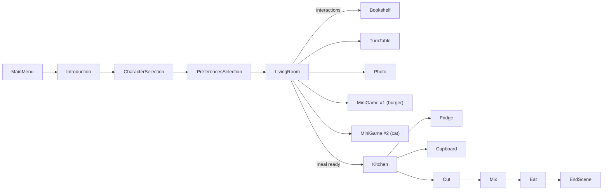
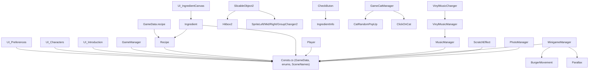

# ByteKitchen: Codebase Wiki

> Map of the sources in `Assets/Scripts` (about 55 C# files, roughly 5,100 lines) plus the
> scene and prefab structure. It helps you see at a glance which file you are looking at, what
> each one does and who depends on whom.
> Last updated: 25 Oct 2026. Parts marked *inferred* come from scene names and shared state,
> not from reading every scene file.

ByteKitchen is a 2D **advergame** made in **Unity (C#)** as a **university group project**: a
promotional cooking game for a fictional kitchen robot. The player picks a character, shares a
mood and a taste, and the robot cooks a matching recipe while the player explores the house and
plays mini-games. It was Renato's **first project with Unity and C#**.

### Renato's part (from the project README)
- textures and visual assets;
- the introduction scenes and the onboarding;
- the **photo cleaning** mini-game;
- the complete **burger** mini-game, built from scratch;
- all the **audio** integration (music and sound effects);
- a significant share of game design and user experience.

---

## 1. How to open and run

Open the project folder with the Unity Hub (the README says Unity 2023.x, Universal Render
Pipeline). Open the `MainMenu` scene and press Play. Scenes are in `Assets/Scenes`.

---

## 2. Game flow (inferred from scene names and shared state)



1. **Introduction**: a typed-out dialogue with the robot; after the fifth line the player
   chooses yes or no (yes goes to character selection, no back to the main menu).
2. **Character and preferences**: choose one of four characters (Mango, Margherita, Alex, Bob)
   and answer two questions: happy or not, sweet or savoury.
3. **Recipe**: `Recipe` maps (character, happy, sweet) to one of 16 recipes and builds its
   ingredient list.
4. **Living room**: a top-down room with interactable objects (bookshelf, turntable and vinyl
   music, lamp, photo to clean, mini-games). After the player has interacted with enough
   objects (two), the meal is declared ready and a message sends the player to the kitchen.
5. **Kitchen**: take ingredients from the fridge and the cupboard, **cut** some of them,
   **mix** (stir) and cook in the oven, then **eat**, then the end scene.

---

## 3. Architecture

| Layer | What it does | Files |
|---|---|---|
| **Shared state and constants** | Scene names, ingredient/recipe/character enums, static `GameData` | `Utils/Consts.cs` |
| **Game flow** | Character activation, "meal ready" logic, end scene | `Game/GameManager.cs`, `Game/EndScene.cs` |
| **Player and world** | Movement, interaction, camera, interactable objects | `Game/Player.cs`, `Game/PlatformerPlayerController.cs`, `Game/InteractableObjectText.cs`, `Game/CameraZoom.cs` |
| **Food** | Recipe selection, ingredients | `Food/Recipe.cs`, `Food/Ingredient.cs` |
| **Cooking steps** | Slice, mix, oven, serve | `Slice/*`, `Mix/StirController.cs`, `Eat/*` |
| **Mini-games** | Burger runner, photo cleaning, cat clicker | `Burger/*`, `Photo/*`, `CatGame/*` |
| **Audio** | Music per scene, vinyl player, volumes | `Game/MusicManager.cs`, `Game/VinylMusic*.cs`, `Game/ChooseMusic.cs`, `Game/StartMusicDelayed.cs`, `Game/SfxVolumeFIx.cs` |
| **UI** | Menus, introduction, preferences, buttons, transitions | `UI/*` |
| **Utilities** | Aspect ratio control | `Utils/AspectRatioController.cs` |

---

## 4. Shared state: `Consts.cs`

The static class `GameData` is the glue between scenes (Unity destroys objects when a scene
changes, so persistent values live here):

| Field | Meaning |
|---|---|
| `characterSelected` | one of `MANGO`, `MARGHERITA`, `ALEX`, `BOB` |
| `isHappy`, `isSweet` | the player's answers, used to choose the recipe |
| `recipe` | the chosen `Recipe` |
| `interactionCount`, `interactedObjects` | counts and records what the player has touched in the living room |
| `isMealReady`, `robotIsCooking` | cooking progress flags |
| `isPhotoClean`, `isLampOn` | state of living room objects |
| `SFXvolume`, `musicVolume`, `currentLivingRoomMusic`, `isVinylMusicPlaying` | audio settings |
| `playerPosition` | where the player returns to when a scene reloads |

`SceneNames` holds every scene name as a constant (no strings scattered in the code).
`Ingredients` (about 40 values) and `Recipes` (16 values) are enums; `SpritesName` maps
ingredients to sprite names.

---

## 5. Dependency graph



Almost everything depends on `Consts.cs`: the shared state is the architecture's backbone.

---

## 6. File by file

### Game flow
- **`GameManager`** (82 lines). On `Awake` activates the chosen character from `GameData`.
  In `Update` watches `interactionCount`; at two interactions sets `isMealReady` and, after a
  second, shows a message with a sound (`ShowMessage` coroutine) that the dish is ready.
- **`EndScene`**. Final scene logic.
- **`Player`** (338 lines). Top-down movement with arrow keys through the new Input System,
  `E` to interact, animator parameters for direction and movement, collisions with interactable
  objects (fridge, cupboard, robot) and a door reference.
- **`PlatformerPlayerController`**. Side-view controller for platform scenes.
- **`InteractableObjectText`** (439 lines). Shows a prompt or message when the player gets near
  an object, driven by a per-object configuration chosen from the object's tag.
- **`CameraZoom`**, **`LampControl`**, **`Bookshelf`** (click to turn a page or remove a book),
  **`TurnTable`** (turntable scene, 176 lines).

### Food
- **`Recipe`** (289 lines). `Recipe(character, isHappy, isSweet)` selects the recipe name with a
  `switch` over character and answers, and fills the ingredient list for that recipe.
- **`Ingredient`** (286 lines). A clickable ingredient object: knows its enum name and sprite,
  whether it is cuttable (`IsCuttable`), whether it belongs to the recipe (`IsInTheRecipe`),
  handles `OnMouseDown`, hover enter/exit.

### Cooking steps
- **`Slice/`**: `SlicableObject2` (slice an ingredient on a side with audio), `Hitbox2`
  (the cut guides), sprite changers for left/middle/right parts, `CheckButon`, `IngredientInfo`.
  `UI/UI_CutButton` ties the cutting scene to the UI.
- **`Mix/StirController`** (236 lines). Stirring: rotation of the spoon/arm, changing fluid
  sprite and colour, audio while stirring.
- **`Eat/`**: `OvenController`, `ReadyMeal`, `ButtonClick`: the oven and serving the meal.

### Mini-games
- **Burger (Renato's)**: `MinigameManager` (162 lines) is a **side-scrolling runner**. It
  scrolls the floor texture, grows the speed over time (`speedIncresePerSecond`), spawns
  obstacles at set delays (**80% ground obstacles, 20% a flying ghost**), accumulates a score,
  plays a sound every 50 points, and stores the **high score in `PlayerPrefs`**. It shows the end
  screen and can restart or leave. `BurgerMovement` handles the burger (jump and crouch driven
  by animation, game over on collision), `Parallax` scrolls background layers.
- **Photo (Renato's)**: `ScratchEffect` (246 lines) is a **scratch-off cleaning mechanic**. An
  overlay texture is copied at start; dragging the pointer with a brush of 160 pixels erases the
  overlay's alpha around the cursor (screen position converted to local UV coordinates). A
  cached mask marks the pixels that count; when the scratched share of the mask reaches **80%**
  the target is reached, a robot message appears and the living room button is enabled. A cloth
  UI element follows the cursor (`ClothUIFollower`), with cleaning sounds. `PhotoManager` loads
  the photo of the selected character.
- **Cat game**: `GameCatManager` starts a mini-game where a cat pops up at random places
  (`CatRandomPopUp`) and the player must click it (`ClickOnCat`), with 10 hits to win and a
  victory panel.

### Audio (Renato's)
- **`MusicManager`** (194 lines). A **singleton** that persists across scenes and holds a
  serialisable list scene name to music clip, so each scene gets its own track.
- **`VinylMusicManager`**, **`VinylMusicChanger`**, **`ChooseMusic`**: the living room record
  player lets the player change the music; `GameData.currentLivingRoomMusic` remembers the choice.
- **`StartMusicDelayed`**, **`SfxVolumeFIx`**: start music with a delay; apply the SFX volume.

### UI
`UI_MainMenu`, `UI_Introduction` (208 lines, typed dialogue with a typing coroutine and a yes/no
choice, robot sprites change with the line), `UI_Characters`, `UI_Preferences`,
`UI_IngredientCanvas`, `UI_Buttons`, `UI_OptionButton`, `UI_OptionPanel`, `UI_KitchenButton`,
`UI_LivingButton`, `UI_CutButton`, `UI_CircleWipe` (circle wipe scene transition).

---

## 7. Folder layout

```
ByteKitchen/
  Assets/
    Animations/      # character and object animations
    Audio/           # music and effects
    Prefabs/         # GameElements, UI (canvas variants), Robot
    Resources/       # sprites loaded by name (Sprites/Robot/..., Sprites/Burger/...)
    Scenes/          # 17 scenes
    Scripts/         # Burger, CatGame, Eat, Food, Game, Mix, Photo, Slice, UI, Utils
  docs/CODEBASE.md
```
